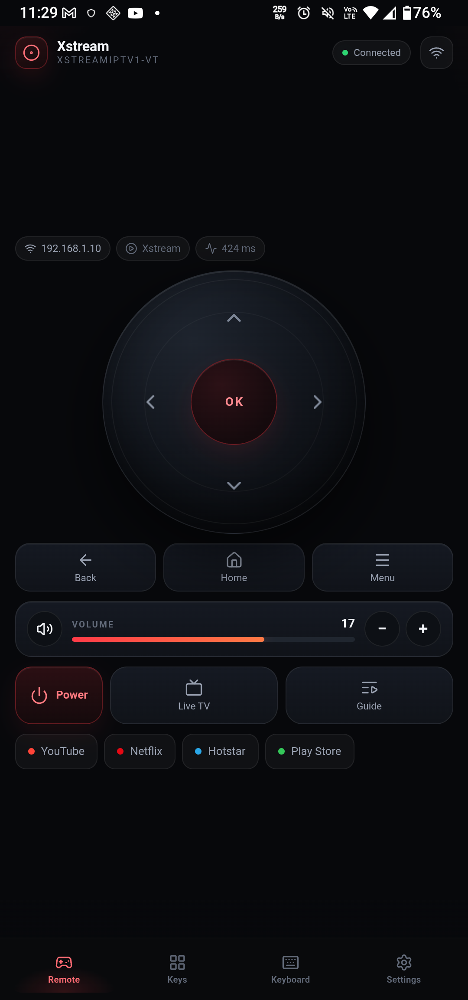
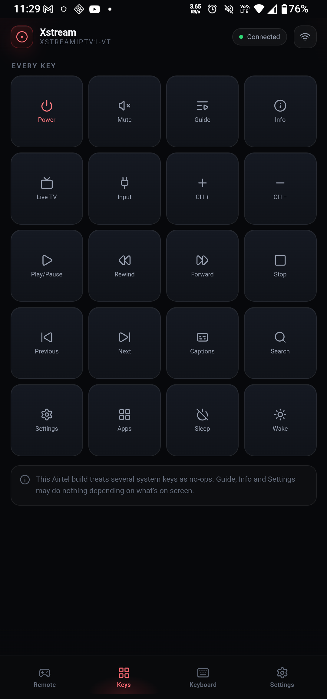
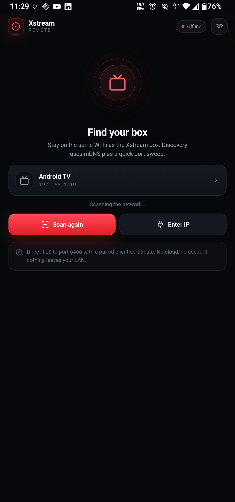
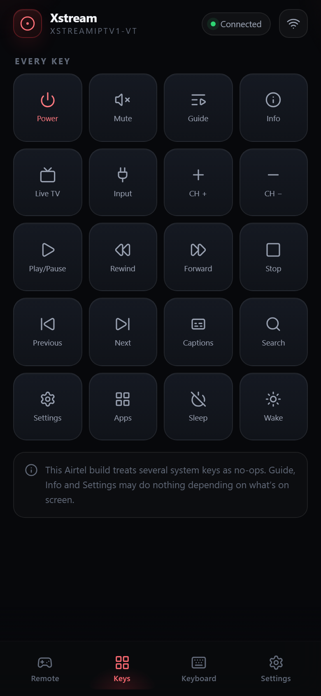
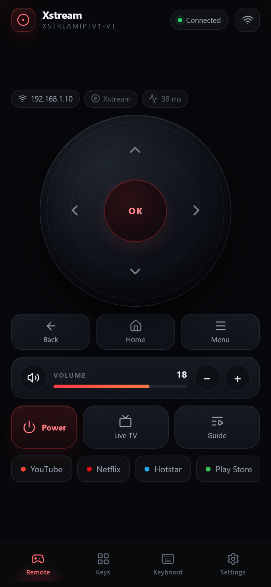
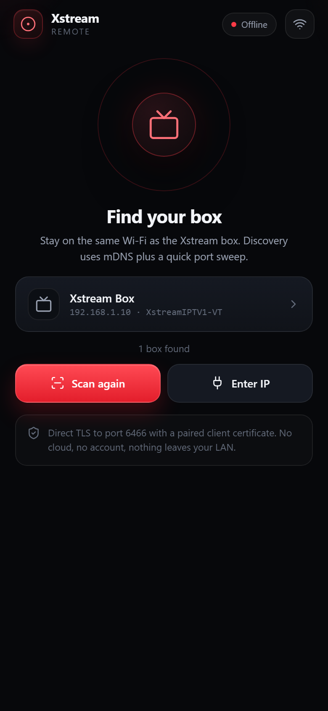

# Xstream Remote

A small, local-first Android remote for **Airtel Xstream** and other
**Android TV / Google TV** boxes. It speaks the Android TV Remote Service v2
protocol directly over your LAN — no cloud, no account, no analytics, and no
bundled client certificate.

**v2.0** · about **118 KB** · Android 7.0+ (API 24) · target API 34

| Remote | Keys | Connect | Keys (detail) | Remote (detail) | Connect (detail) |
|:---:|:---:|:---:|:---:|:---:|:---:|
|  |  |  |  |  |  |

More UI shots are in [`docs/screenshots/`](docs/screenshots/).

## What works

- **Pair from the phone** — the TV shows a six-character code; enter it once.
  The phone creates its own RSA identity and stores it in app-private storage.
- **Pinned, direct control** — TLS on port 6466. The TV certificate is pinned
  after pairing; a different certificate at the same IP is rejected.
- **One-thumb remote** — red-glow pad, D-pad, OK, Back, Home, volume, mute,
  channel and playback rails.
- **App-aware controls** — the context bar follows what is on the TV:
  - Live TV: Guide / Options / Captions.
  - Media apps: Search / Captions / Options, with a Rewind / Play / Forward
    playback rail.
  - Other apps: Recent apps / Search / Home.
- **Every key** — a 22-key grid including Menu and Assistant, plus a numbers
  pad for channel and PIN entry.
- **Haptics** — a native tick for every key, a firmer OK, long-press and
  success/error patterns. Touch feedback and motion can be turned off.
- **Comfort mode** — larger controls and always-on labels for one-handed or
  less precise use.
- **Keyboard** — send text to the TV's focused search or login field.
- **Macros** — key, app-launch, text and wait steps, runnable from a tile.
- **App shortcuts** — deep links that work on this box:
  YouTube, Netflix, Hotstar, Prime Video, Spotify store search, Play Store.
- **Customization** — theme, labels, pad size, rail side, channel rail, tiles,
  gestures, import/export and reset.
- **Small and inspectable** — one WebView, hand-written protobuf, Lucide icons,
  no Gradle, no AndroidX, no runtime SDKs.

## What is not here yet

- Home-screen widgets, a Quick Settings tile, and a media notification.
- Real brand artwork for every app tile.
- A multi-TV device manager. One paired box is remembered at a time.
- Validation against a second TV model. Pairing is real on the Airtel box; the
  full pairing exchange also passes against the local protocol mock.

The app does **not** bypass DRM, subscriptions or credentials. It only sends
remote-control commands to a box you own or are authorized to control.

## Install

Build the APK (below) and install it on the phone:

```powershell
adb install -r apk\XstreamRemote-2.0.apk
```

Or copy the APK to the phone and open it. The phone and TV must be on the same
LAN; guest Wi-Fi, VLAN separation and AP isolation will block discovery and
control.

The repository does **not** ship a prebuilt APK. A debug-signed test build is
fine for your own phone; use your own release key before distributing a build.

## Live site & download

- **Landing page:** [https://vijayaapardhu.dev/xstream-remote/](https://vijayaapardhu.dev/xstream-remote/)
- **Direct APK download:** [XstreamRemote-2.0.apk](https://github.com/Vijayapardhu/xstream-remote/releases/download/v2.0.0/XstreamRemote-2.0.apk) (v2.0.0, ~226 KB, source-only repo)

## Release download

A **release-style signed APK** is produced from this source:

```text
apk\XstreamRemote-2.0.apk   (226 KB, v2 + v3 signatures, ~18 KB UI + ~75 KB dex)
```

Build it:

```powershell
cd apk
$env:XSTREAM_STORE_PASS = "your-keystore-password"
powershell -ExecutionPolicy Bypass -File build.ps1
```

Install:

```powershell
adb install -r apk\XstreamRemote-2.0.apk
```

Or copy `apk\XstreamRemote-2.0.apk` onto the phone and open it (allow file
install).

## Setup box guide

How the release APK was made and validated using the Airtel Xstream box, and how
to pair with it:

- `docs/SETUP_BOX.md` — setup box instructions, build steps, pairing flow,
  live-verified features, future items.

## Pair

1. Open the app on the phone and make sure the phone and TV are on the same
   Wi-Fi.
2. Tap **Scan**, or enter the TV's IP address manually.
3. The TV displays a six-character code. Enter it in the app.
4. On success the app pins the TV certificate and connects.

The pairing exchange runs on port **6467**; normal control runs on **6466**.
The client private key never leaves the phone's app-private storage. Re-pair
from **Settings → Pair / re-pair this box** after a TV reset or network change.

## Build

### Requirements

- JDK 11+ (tested with JDK 24)
- Android SDK **build-tools 34.0.0** and **platform android-34** (`android.jar`)
- Python 3.9+ (rebuilds the UI and Lucide sprite)
- Windows for the current `build.ps1`; the Java and UI sources are portable

The Lucide SVGs are committed under `apk/icons/`, so the icon step works
offline.

### Release-style build

```powershell
cd apk
$env:XSTREAM_STORE_PASS = "choose-a-keystore-password"
powershell -ExecutionPolicy Bypass -File build.ps1
```

The script creates `apk\keystore.jks` on first run if it is missing. Keep the
keystore and its password out of Git.

To use an existing keystore:

```powershell
$env:XSTREAM_KEYSTORE = "C:\path\to\your.jks"
$env:XSTREAM_KEY_ALIAS = "your-alias"
$env:XSTREAM_STORE_PASS = "your-password"
```

SDK paths can be overridden:

```powershell
$env:ANDROID_BUILD_TOOLS = "C:\Android\Sdk\build-tools\34.0.0"
$env:ANDROID_JAR = "C:\Android\Sdk\platforms\android-34\android.jar"
```

Output: `apk\XstreamRemote-2.0.apk`. The build bundles only
`assets/ui/index.html`; it does not read `client.pem` or `client.key`, and the
APK contains no client identity.

For a local test build with the standard Android debug key:

```powershell
$env:XSTREAM_STORE_PASS = "android"
$env:XSTREAM_KEYSTORE  = "$env:USERPROFILE\.android\debug.keystore"
$env:XSTREAM_KEY_ALIAS = "androiddebugkey"
powershell -ExecutionPolicy Bypass -File build.ps1
```

## Test

The UI has a headless Chrome flow test. It runs the page in `?preview=1` mode,
which stubs the native bridge and records every key, launch, text, macro and
haptic call:

```powershell
node apk\tools\ui-test.js
```

The test covers navigation, customization, macros, pairing dialogs, the
app-aware context bar, the media rail, all 22 keys, the numbers pad, the
keyboard, mute state, volume repeat, and comfort settings.

## How it works

```text
Phone
┌──────────────────────────────────────────────────────────────┐
│  WebView UI  (HTML/CSS/JS + inline Lucide sprite)            │
│       │  window.Native  /  window.__tv                       │
│  MainActivity  ──  TvBridge  ──  AurSession  ── TLS 6466 ──► │  Android TV box
│                       │                                      │
│              PairingSession ── TLS 6467 ── TV pairing code   │
│                       │                                      │
│                 ClientIdentity (per-install RSA + cert)      │
└──────────────────────────────────────────────────────────────┘
```

- `PairingSession` implements the port-6467 handshake and derives the shared
  secret from the client, server and six-character code.
- `ClientIdentity` generates a 2048-bit RSA keypair and a compact self-signed
  DER certificate on first pair; no BouncyCastle.
- `AurSession` opens TLS to port 6466, speaks varint-framed protobuf, answers
  pings, and injects keys, text, volume and app links.
- `TvBridge` owns discovery, pairing, pinning, reconnect, app events, macros
  and the UI state.
- `MainActivity` hosts the WebView and exposes the native bridge and haptics.
- The APK is assembled with plain SDK tools: `aapt2` → `javac` → `d8` → zip
  assets → `zipalign` → `apksigner`.

WebView debugging is off by default. For a debug session:

```powershell
adb shell am start -n com.xstream.remote/.MainActivity --ez xstream_debug true
```

## Project layout

```text
apk/
  AndroidManifest.xml
  build.ps1                  # aapt2/javac/d8/zipalign/apksigner pipeline
  java/com/xstream/remote/   # MainActivity, TvBridge, AurSession, pairing, discovery
  res/                       # theme, launcher icons, strings
  web/                       # index.template.html + Lucide sprite
  tools/                     # UI builder, icon fetch, screenshot and UI test helpers
  test/                      # JVM protocol harnesses
  assets/ui/index.html       # generated, committed for convenience
remote/
  server.py                  # optional Python bridge / laptop remote
docs/
  ARCHITECTURE.md
  INSTALL.md
  ROADMAP.md
  screenshots/
```

## Security and privacy

- **LAN only.** No cloud endpoints, analytics, accounts, or ads.
- **No DRM or subscription bypass.** It only sends Android TV Remote Service
  commands to a device you control.
- **Per-install identity.** The phone generates its own RSA key and certificate
  on first use. They are stored in the app's private files directory and are
  never packaged into the APK or logged.
- **TV pinning.** After pairing, the TV's SHA-256 certificate fingerprint is
  stored per host and enforced on reconnect.
- **Signing key.** `apk/keystore.jks` and its password are local secrets and are
  gitignored.
- **Local bridge.** The optional Python bridge is a development tool. Do not
  expose its port to the internet.

## Tested on

- **Phone:** Motorola Edge 50 Fusion, Android 16.
- **TV:** Airtel Xstream box, `XSTREAMIPTV1-VT`, software `7.00.999235495`,
  Android TV Remote Service on a private LAN.
- **Live checks:** connect, app-aware context, 22 keys, volume/mute (including
  hold-to-repeat), haptics, macros, numbers, app links, and reconnect.
- **Pairing:** real TV pairing reaches the six-character-code step; the full
  exchange is verified against the local protocol mock. Completion needs the
  code shown on the TV.

Other Android TV / Google TV boxes should work if they expose the standard
Android TV Remote Service. They have not all been tested yet.

## Credits

- Icons: [Lucide](https://lucide.dev) (ISC).
- Protocol reference and the optional bridge:
  [androidtvremote2](https://github.com/tronikos/androidtvremote2) (Apache-2.0).
- See [`THIRD_PARTY_NOTICES.md`](THIRD_PARTY_NOTICES.md).

Not affiliated with Airtel, Google, Vantiva, or the Android TV project. All
trademarks belong to their owners. Use this only on devices you own or are
authorized to control.

## License

[MIT](LICENSE)
